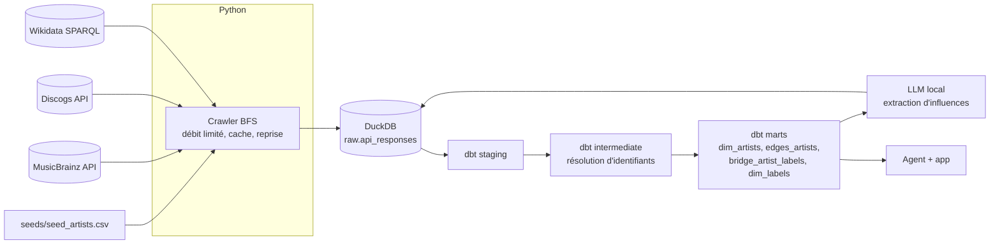

# Lineage — le graphe d'influences de la witch house

> D'où vient un son, qui l'a porté, sur quels labels, et comment s'en inspirer en studio.

Lineage reconstruit le graphe de la scène **witch house** et de ses voisins (Crystal Castles, Salem,
Snow Strippers, Crim3s…) à partir de données ouvertes. Un LLM extrait les influences enfouies dans les
biographies, et un agent s'appuie sur ce graphe pour donner des **conseils de production** sourcés.

Projet portfolio d'analytics engineering : ingestion, modélisation dbt, qualité des données, LLM et agent.

## Architecture



## Démarrage rapide (Windows / PowerShell)

```powershell
# 1. Environnement Python
py -m venv .venv
.venv\Scripts\Activate.ps1
pip install -e ".[dev]"

# 2. Configuration
copy .env.example .env      # puis remplis LINEAGE_CONTACT et DISCOGS_TOKEN

# 3. Vérifier que tout marche, sans réseau, sur des artistes fictifs
pytest
python tests\make_demo_db.py data\demo.duckdb
cd transform; dbt build --profiles-dir . --target demo; cd ..

# 4. Le vrai crawl (quelques heures : MusicBrainz limite à ~1 requête/s)
python -m lineage.crawl --depth 2 --max-artists 400

# 5. Modélisation
cd transform; dbt build --profiles-dir .; cd ..
```

Le crawl est **reprenable** : interromps-le avec Ctrl+C et relance la même commande, il repart où il
s'était arrêté. Les réponses déjà téléchargées depuis moins de `LINEAGE_REFRESH_DAYS` jours ne sont pas
redemandées.

## Modèle de données

| Couche | Modèle | Grain |
|---|---|---|
| raw | `api_responses` | une réponse API (JSON brut) par (source, type, id) |
| staging | `stg_musicbrainz__artists` | un artiste |
| staging | `stg_musicbrainz__relations` | une relation artiste → artiste / label / URL |
| staging | `stg_musicbrainz__release_labels` | un couple (sortie, label) |
| staging | `stg_discogs__artists` | une fiche Discogs avec sa bio |
| staging | `stg_wikidata__influences` | une relation P737 « influencé par » |
| intermediate | `int_artist_external_ids` | correspondance MBID ↔ Discogs ↔ Wikidata |
| intermediate | `int_artist_edges__unioned` | arêtes orientées et dédoublonnées, toutes sources |
| marts | `dim_artists`, `dim_labels` | un artiste, un label |
| marts | `edges_artists` | une arête du graphe, avec sa source et sa justification |
| marts | `bridge_artist_labels` | artiste × label, avec la période d'activité |

## Choix de conception

- **Crawl par API plutôt que dumps complets.** La scène est une niche : télécharger des dizaines de Go
  pour en garder quelques Mo n'a pas de sens. Le crawl part d'artistes choisis à la main et s'étend
  à 2 sauts.
- **Couche brute en JSON, logique dans dbt.** Le crawler ne transforme rien. Si on change de
  modélisation, on rejoue dbt sans re-télécharger.
- **MusicBrainz comme pivot.** Ses relations URL donnent les identifiants Discogs et Wikidata : la
  résolution d'entités est exacte quand le lien existe, au lieu d'un rapprochement flou sur les noms.
- **Traçabilité de chaque arête.** `edges_artists.source_system` dit d'où vient chaque affirmation. Une
  arête produite par le LLM sans citation fait échouer les tests (`assert_llm_edges_have_evidence`).
- **Le LLM ne peut pas inventer.** Toute influence extraite doit citer une phrase présente mot pour mot
  dans la bio source ; sinon elle est rejetée (`validate_against_source`).

## Feuille de route

- [x] Crawler multi-sources avec débit limité, cache et reprise
- [x] Modèles dbt staging → marts et tests de qualité
- [ ] Mesurer la couverture de la scène dans chaque source (notebook de profilage)
- [ ] Extraction LLM des influences (`python -m lineage.extract.run`) + modèle dbt des arêtes `llm`
- [ ] Jeu d'évaluation : 50 influences vérifiées à la main, précision mesurée en CI
- [ ] Fiches de style (attributs de production par artiste), validées à la main
- [ ] Analyse audio (Essentia / librosa) : comparer un morceau à ses références
- [ ] Agent coach de production + app avec le graphe interactif
- [ ] Observabilité de l'agent (logs → dbt → dashboard)

## Données et licences

- [MusicBrainz](https://musicbrainz.org/doc/MusicBrainz_API) : données principales sous CC0.
- [Discogs API](https://www.discogs.com/developers) : soumise aux conditions d'utilisation de l'API.
- [Wikidata](https://query.wikidata.org/) : CC0.

Les données téléchargées restent en local (`data/` est ignoré par git) : le dépôt ne publie que le code.
