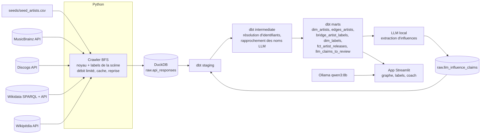
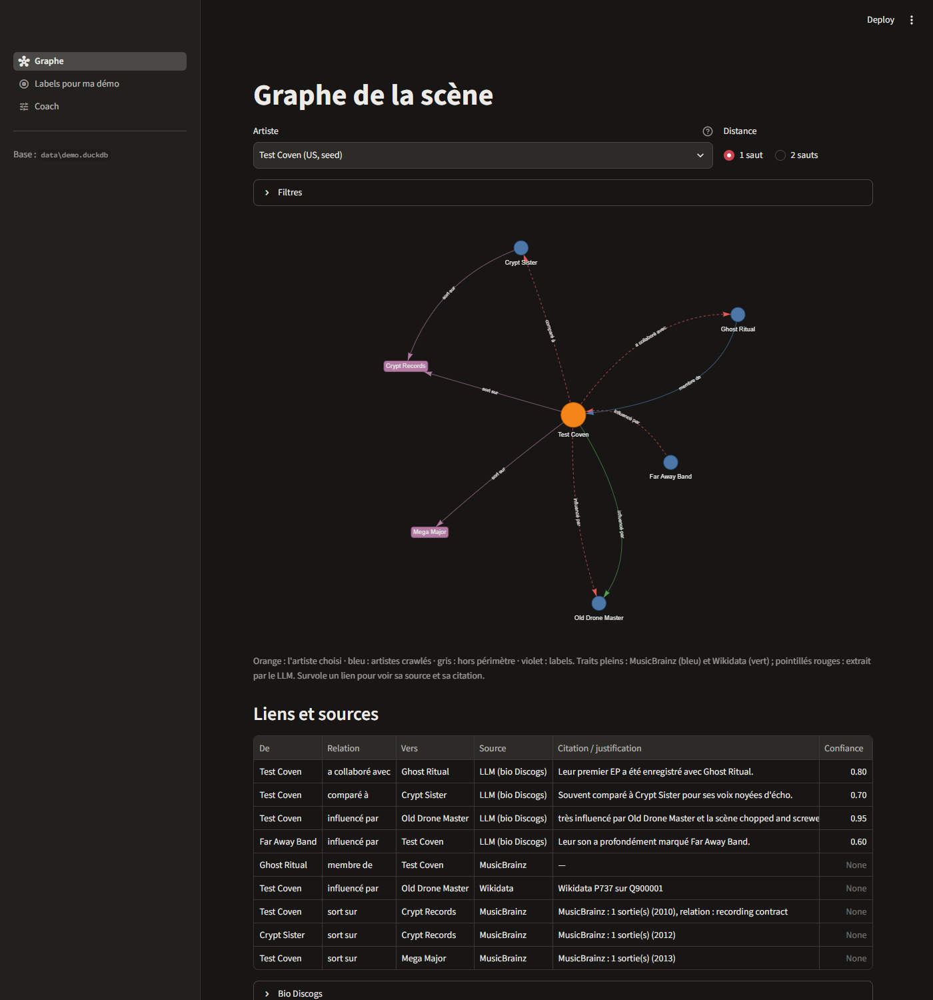
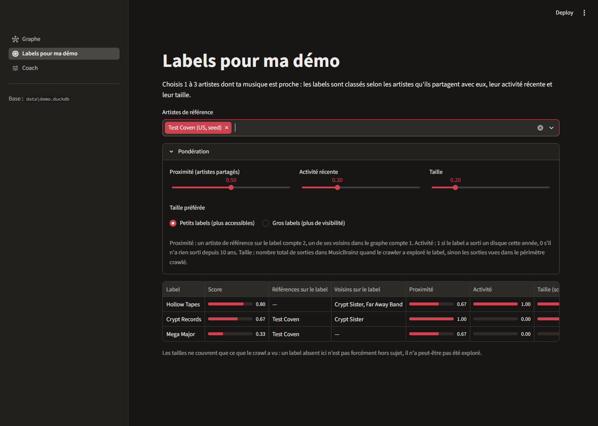
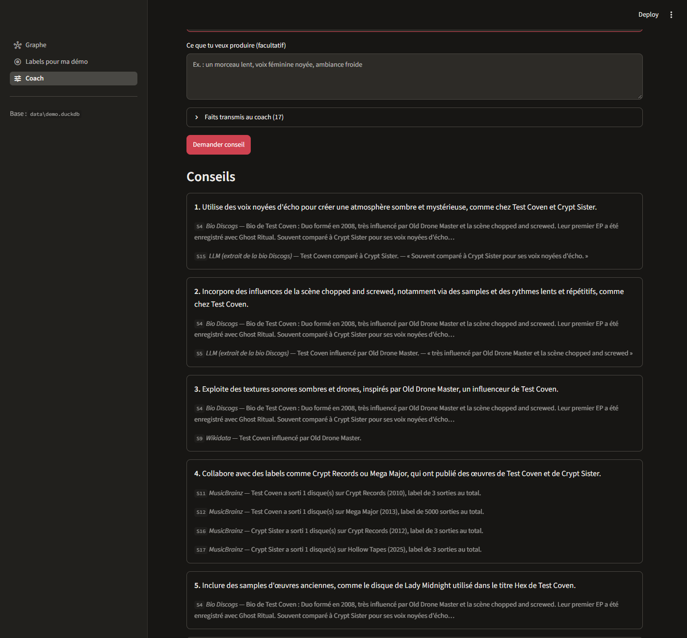

# Lineage — le graphe d'influences de la witch house

> D'où vient un son, qui l'a porté, sur quels labels, et comment s'en inspirer en studio.

Lineage reconstruit le graphe de la scène **witch house** et de ses voisins (Crystal Castles, Salem,
Snow Strippers, Crim3s…) à partir de données ouvertes. Un LLM extrait les influences enfouies dans les
articles Wikipédia et les biographies Discogs, et un agent s'appuie sur ce graphe pour donner des
**conseils de production** sourcés.

Projet portfolio d'analytics engineering : ingestion, modélisation dbt, qualité des données, LLM et agent.

## Architecture



## Démarrage rapide (Windows / PowerShell)

```powershell
# 1. Environnement Python
py -m venv .venv
.venv\Scripts\Activate.ps1
pip install -e ".[dev,app]"

# 2. Configuration
copy .env.example .env      # puis remplis LINEAGE_CONTACT et DISCOGS_TOKEN

# 3. Vérifier que tout marche, sans réseau, sur des artistes fictifs
pytest
python tests\make_demo_db.py data\demo.duckdb
cd transform; dbt build --profiles-dir . --target demo; cd ..

# 4. Lancer l'app sur la démo (http://localhost:8501)
streamlit run app/main.py -- --db data/demo.duckdb

# 5. Le vrai crawl (MusicBrainz : une requête toutes les 1,5 s)
python -m lineage.crawl --depth 2 --max-artists 400

# 6. Modélisation, extraction LLM des influences, puis modélisation à nouveau
cd transform; dbt build --profiles-dir .; cd ..
python -m lineage.extract.run
cd transform; dbt build --profiles-dir .; cd ..

# 7. L'app sur les vraies données (data/lineage.duckdb par défaut)
streamlit run app/main.py
```

Le coach et l'extraction utilisent [Ollama](https://ollama.com) en local : installe-le puis
`ollama pull qwen3:8b`. Sans Ollama, les pages Graphe et Labels fonctionnent ; le coach le signale.

Le crawl est **reprenable** : interromps-le avec Ctrl+C et relance la même commande, il repart où il
s'était arrêté. Les réponses déjà téléchargées depuis moins de `LINEAGE_REFRESH_DAYS` jours ne sont pas
redemandées.

Une API saturée n'arrête pas le crawl. Sur 429 / 503, le client respecte l'en-tête `Retry-After`
(sinon attente exponentielle), avec 8 tentatives au plus et 120 s d'attente maximum ; une requête
MusicBrainz part au plus toutes les 1,5 s. Si un artiste ou un label échoue malgré tout, l'erreur est
journalisée et l'élément est repris au run suivant : les artistes en `error` repassent en attente, et
les labels d'un artiste ne sont marqués explorés que si tous ont répondu.

### Périmètre du crawl

Une scène de niche se perd vite : au premier crawl en profondeur 2, chaque label (jusqu'à 300 sorties)
de chaque artiste faisait entrer tous ses artistes, eux-mêmes étendus à leur tour. Résultat : **7 142
artistes en attente**, avec Leona Lewis, Afrojack ou Status Quo. Le périmètre est maintenant défini ainsi :

- **le noyau** : les artistes de départ, et ceux qui leur sont reliés par MusicBrainz (membres, alias,
  collaborations) ou Wikidata (influences), jusqu'à `--depth` sauts. Seuls eux sont étendus ;
- **les labels de la scène** : au plus `--label-max-releases` sorties (100 par défaut) **et** partagés
  par au moins `--label-min-core-artists` artistes du noyau (2 par défaut). Leurs artistes sont crawlés
  (fiche, sorties, bio, article) mais jamais étendus ;
- **hors périmètre** : le reste. Rien n'est supprimé : `python -m lineage.crawl --depth 2 --rescope`
  recalcule le périmètre depuis le cache et affiche le bilan, `--apply` l'écrit. Les artistes en
  attente hors périmètre passent en `out_of_scope` (réversible), ceux déjà crawlés restent en base avec
  `dim_artists.perimeter = 'out'`, et l'app les masque par défaut.

Compter les artistes du **noyau**, et pas tous les artistes déjà crawlés, est ce qui fait la différence :
la moitié des artistes crawlés venaient déjà de labels hors sujet, et comptés tels quels ils faisaient
passer des labels comme Inertia (Robyn, Röyksopp). Avec le noyau, il reste exactement 4 labels :
Disaro, Merok Records, Emotion et Lovepump United, et la file passe de 7 142 à 49 artistes en attente.

On peut **augmenter `--depth` d'un run à l'autre** : les artistes du noyau qui étaient à l'ancienne
profondeur max ajoutent leurs voisins à partir du cache, et les labels partagés sont recalculés.

## L'app

`streamlit run app/main.py` (base réelle) ou `streamlit run app/main.py -- --db data/demo.duckdb`
(démo fictive). On peut aussi passer la base par la variable `LINEAGE_APP_DB`. L'app lit uniquement les
marts, en lecture seule, et referme la connexion après chaque requête : on peut la laisser ouverte
pendant un `dbt build`. Si un crawl tient le verrou de la base, l'app le dit et propose la démo.

**Graphe.** On cherche un artiste et on voit ses voisins à 1 ou 2 sauts : influences, membres,
collaborations, labels et autres artistes de ces labels. Chaque lien affiche sa source au survol et dans
le tableau en dessous ; les liens extraits par le LLM sont en pointillés et citent le passage de
l'article Wikipédia ou de la bio Discogs d'où ils viennent. Filtres par source et par confiance du LLM.
Un interrupteur de la barre latérale affiche aussi les artistes hors périmètre.



**Labels pour ma démo.** On choisit 1 à 3 artistes de référence ; les labels qui ont au moins un artiste
en commun avec eux ou leurs voisins sont classés selon trois critères pondérables :
- proximité : une référence sur le label compte 2, un voisin dans le graphe compte 1 ;
- activité récente : 1 si dernière sortie cette année, 0 au-delà de 10 ans ;
- taille : nombre total de sorties MusicBrainz, en préférant les petits ou les gros labels.

Le tableau indique quels artistes partagés justifient chaque label.



**Coach.** On choisit des inspirations ; l'app transforme leurs données (identité, genres, tags,
passages Wikipédia sur le style, bio Discogs, arêtes du graphe avec citations, labels) en faits numérotés `S1, S2…`, seul contexte donné à
qwen3:8b. La réponse est contrainte en JSON : chaque conseil liste les faits qui le justifient, et un
conseil sans source ou citant un fait inexistant est écarté et montré à part.



Limite connue : on vérifie que les sources citées **existent**, pas qu'elles **justifient** vraiment le
conseil. Sur la démo, qwen3:8b propose par exemple des « textures de drone » en s'appuyant sur le seul
nom d'Old Drone Master. Le jeu d'évaluation de la feuille de route devra mesurer ce point.

## Modèle de données

| Couche | Modèle | Grain |
|---|---|---|
| raw | `api_responses` | une réponse API (JSON brut) par (source, type, id) |
| staging | `stg_musicbrainz__artists` | un artiste |
| staging | `stg_musicbrainz__relations` | une relation artiste → artiste / label / URL |
| staging | `stg_musicbrainz__release_labels` | un couple (sortie, label), `[no label]` signalé par `is_placeholder_label` |
| staging | `stg_discogs__artists` | une fiche Discogs avec sa bio, brute et nettoyée de son balisage |
| staging | `stg_wikipedia__articles` | un article Wikipédia anglais en texte brut, sections comprises |
| staging | `stg_wikidata__influences` | une relation P737 « influencé par » |
| staging | `stg_musicbrainz__labels` | un label exploré par le crawler, avec son nombre total de sorties |
| staging | `stg_llm__influence_claims` | une affirmation du LLM avec sa citation et son texte source (version courante de l'extracteur) |
| intermediate | `int_artist_external_ids` | correspondance MBID ↔ Discogs ↔ Wikidata |
| intermediate | `int_llm_claims__resolved` | une affirmation du LLM, l'autre artiste rapproché d'un MBID (`matched` / `ambiguous` / `no_match`) |
| intermediate | `int_artist_edges__unioned` | arêtes orientées et dédoublonnées, toutes sources (MusicBrainz, Wikidata, LLM) |
| marts | `dim_artists`, `dim_labels` | un artiste (textes, `perimeter`), un label (`n_releases_total` = taille réelle) |
| marts | `edges_artists` | une arête du graphe, avec sa source, sa justification et la confiance du LLM |
| marts | `llm_claims_to_review` | une affirmation du LLM non rapprochée, à revoir à la main |
| marts | `bridge_artist_labels` | artiste × label, avec la période d'activité (vrais labels uniquement) |
| marts | `fct_artist_releases` | artiste × sortie, avec ses labels et `is_self_released` |

## Couverture des sources : ce que le premier crawl a montré

Premier crawl : profondeur 1, 24 artistes.

- **Wikidata : aucune influence (P737) pour toute la scène.** Ce n'est pas un bug, la donnée n'existe
  pas : P737 est renseignée pour des artistes canoniques, pas pour une micro-scène des années 2010.
  C'est ce qui justifie l'extraction par LLM depuis les bios Discogs.
- **MusicBrainz ne donne que des liens membre / alias**, c'est-à-dire l'identité des projets, pas la
  scène : qui joue avec qui, qui sort chez qui.
- **Ce sont les labels partagés qui relient la scène** (Disaro, Tri Angle, Lovepump United…). D'où
  l'expansion du crawl par labels de niche.
- **`[no label]` remontait comme le premier label de la scène** (7 artistes, 56 sorties). C'est la
  convention MusicBrainz pour l'autoproduction, pas un label : il est maintenant exclu des marts de
  labels et converti en indicateur au niveau des sorties.

## Les textes du LLM : Discogs n'a pas d'influences, Wikipédia si

La première extraction lisait seulement les bios Discogs : **35 bios, 5 affirmations**, et aucune
vraie influence. Les bios font 300 caractères en moyenne et donnent des faits d'état civil
(« US band from Traverse City and Chicago, founded 2006 » pour SALEM). Le peu de relations trouvées
étaient des membres déjà connus par MusicBrainz, ou des genres pris pour des artistes (« soul »,
« Basque folk music »). Le balisage Discogs (`[a=Crystal Castles]`, `[a1069428]`) polluait en plus
les citations.

D'où quatre changements :

- **Wikipédia comme source principale.** Le QID Wikidata (fourni par MusicBrainz) donne le titre de
  l'article anglais (sitelink `enwiki`), et l'API MediaWiki le texte brut avec ses sections. Les
  articles d'artistes ont souvent une section « Musical style and influences » : elle est lue en
  premier, puis l'introduction, puis le reste de l'article (sans discographie, références…), découpé
  en morceaux de 3 000 caractères (6 au plus). Débit d'une requête par seconde et User-Agent avec
  contact, selon la politique Wikimedia.
- **Bios Discogs nettoyées par dbt** (macro `clean_discogs_markup`, testée) : Python envoie au LLM le
  texte nettoyé, et dbt y revérifie la citation, avec une seule implémentation du nettoyage.
- **Des numéros de phrases au lieu de citations recopiées.** Le texte est envoyé en phrases numérotées
  et le LLM renvoie le numéro de la phrase qui justifie chaque relation ; la citation stockée est la
  phrase originale, et le code vérifie que l'artiste nommé y figure. Avec des citations recopiées,
  qwen3:8b réécrivait le texte : « …shared bills with many bands including Suicide, Ruins, Arab on
  Radar… » devenait une phrase inventée par groupe, toutes rejetées. Normaliser apostrophes et tirets
  n'en aurait sauvé aucune : ce n'était pas de la typographie mais de la reformulation.
- **Des filtres faits par le code, pas seulement par le prompt.** qwen3:8b ignore une partie des
  consignes ; le code écarte donc les genres, courants, lieux, labels et œuvres pris pour des artistes,
  toute relation avec un membre ou un alias déjà connu par MusicBrainz, et les « collaborations » qui
  ne sont qu'une affiche, une tournée ou un festival partagés. Chaque affirmation garde son texte
  source (`text_source`) ; dbt ne garde que la version courante de l'extracteur (variable
  `llm_extractor_version`, aujourd'hui 3) et revérifie chaque citation dans son texte.

**Résultat sur le vrai crawl** (88 artistes du périmètre, 33 articles Wikipédia, 55 bios Discogs) :

| | Discogs seul (v1) | Wikipédia + Discogs (v3) |
|---|---|---|
| affirmations gardées | 5 | 208 (205 de Wikipédia, 3 de Discogs) |
| artistes avec au moins une affirmation | 4 | 29 via Wikipédia, 3 via Discogs |
| arêtes `llm` dans le graphe | 2 | 21, dont 18 entre deux artistes crawlés |
| rejets par les filtres | – | 109 (39 affiches ou tournées, 27 doublons, 20 artiste absent de la phrase, 13 membres ou alias, 9 genres ou labels, 1 l'artiste lui-même) |

Ce que montre une lecture à la main :

- **Les vraies influences sont là, mais hors du graphe.** « Musical influences included Kraftwerk,
  New Order, Orchestral Manoeuvres in the Dark, Pet Shop Boys and Yello » (Crystal Castles), « Chris
  Dexter has listed Jana Hunter and Matteah Baim as influences » (oOoOO), « Sade's music and fashion
  sense are a big influence for Greene » (Washed Out). Les influences pointent par nature hors de la
  scène crawlée : 187 affirmations sur 208 attendent dans `llm_claims_to_review`, faute de MBID.
- **Le type de relation reste le point faible.** Sur les influences et comparaisons, environ 6 sur 10
  sont justes. Les erreurs typiques : un ancien membre (« her work with Dirty Projectors as full-time
  member ») ou un remix (« The EP includes remixes from both Zola Jesus and Pictureplane ») classés en
  influence, un média pris pour un artiste (« According to Heather Phares of AllMusic »). Les listes
  de remixes (« "Crimewave" [by Crystal Castles] (2010) ») sortent en `sampled` : le lien est réel,
  mais c'est un remix, que le schéma ne sait pas encore nommer.
- **Discogs ne sert presque à rien pour les influences** (3 affirmations sur 55 bios) ; il reste utile
  pour les labels et les sorties.

## Choix de conception

- **Crawl par API plutôt que dumps complets.** La scène est une niche : télécharger des dizaines de Go
  pour en garder quelques Mo n'a pas de sens. Le crawl part d'artistes choisis à la main et s'étend
  à 2 sauts.
- **Couche brute en JSON, logique dans dbt.** Le crawler ne transforme rien. Si on change de
  modélisation, on rejoue dbt sans re-télécharger.
- **MusicBrainz comme pivot.** Ses relations URL donnent les identifiants Discogs et Wikidata : la
  résolution d'entités est exacte quand le lien existe, au lieu d'un rapprochement flou sur les noms.
- **Traçabilité de chaque arête.** `edges_artists.source_system` dit d'où vient chaque affirmation. Une
  arête produite par le LLM sans citation fait échouer les tests (`assert_llm_edges_have_evidence`).
- **Les labels de la scène comme arêtes, avec un seuil.** Partager un label de 50 sorties dit
  quelque chose ; partager Polydor, Fiction ou [PIAS] ne dit rien et ferait exploser le crawl. Un label
  n'est exploré que s'il a au plus N sorties au total (`--label-max-releases`, 100 par défaut) et qu'il
  est partagé par au moins 2 artistes du noyau (voir « Périmètre du crawl »). La
  première page de l'API donne ce total : un gros label ne coûte qu'une requête, et son payload est
  stocké tronqué (`complete: false`). Si on relève le seuil plus tard, il est re-téléchargé. Les
  artistes découverts ainsi gardent leur provenance (`discovered_via = musicbrainz:label:<nom>`) et
  « Various Artists » est ignoré.
- **Autoproduction : un indicateur, pas un label.** `[no label]` est identifié par son MBID
  (`157afde4-…`, variable dbt `mb_placeholder_label_mbids`), jamais par son nom : `[PIAS]` est un
  vrai label avec des crochets. `fct_artist_releases.is_self_released` vaut `true` si MusicBrainz
  indique explicitement `[no label]`, `false` s'il y a un vrai label, et `null` s'il n'y a aucune info
  de label : une donnée manquante n'est pas une autoproduction. Le test `assert_no_placeholder_labels`
  garantit que `[no label]` ne revient pas dans `dim_labels` ni `bridge_artist_labels`.
- **Le LLM ne peut pas inventer.** Toute influence extraite doit citer un passage présent mot pour mot
  dans le texte source (article Wikipédia ou bio nettoyée) ; sinon elle est rejetée
  (`validate_against_source`). dbt le revérifie dans le texte d'où elle vient
  (`assert_llm_evidence_in_bio`) et exige une citation sur chaque arête `llm`
  (`assert_llm_edges_have_evidence`).
- **Rapprocher les noms du LLM sans deviner.** Le LLM écrit un nom (« The Crypt-Sister »), le graphe
  veut un MBID. Le nom est normalisé (casse, accents, ponctuation, « the » initial, « & ») puis cherché
  d'abord parmi les artistes crawlés, ensuite parmi les artistes cités par les relations MusicBrainz.
  Un seul MBID : l'arête entre dans le graphe. Plusieurs (homonymes) ou aucun : l'affirmation part dans
  `llm_claims_to_review` avec les MBID candidats, plutôt qu'un rapprochement flou qui créerait de fausses
  arêtes. Un test unitaire dbt (`llm_name_resolution`) couvre ces cas. Le sens est normalisé :
  « A a influencé B » devient l'arête `B influenced_by A`.
- **Un coach qui cite ses sources.** Même règle pour le coach : il ne reçoit que des faits numérotés
  issus du graphe et des bios, et tout conseil sans source valide est écarté.
- **Tests de bout en bout sur la démo.** `pytest` construit la base fictive, lance `dbt build` dessus
  dans un dossier temporaire, puis teste la logique de l'app et affiche chaque page avec
  `streamlit.testing` (Ollama simulé ou absent).

## Feuille de route

- [x] Crawler multi-sources avec débit limité, cache et reprise
- [x] Modèles dbt staging → marts et tests de qualité
- [x] Expansion du crawl par labels de la scène (seuil de sorties, partage par le noyau, `--rescope`)
- [x] Wikipédia comme source de texte pour l'extraction
- [ ] Mesurer la couverture de la scène dans chaque source (notebook de profilage ; premiers constats ci-dessus)
- [x] Modèle dbt des arêtes `llm` : rapprochement des noms, revue des noms non rapprochés
- [x] Lancer l'extraction LLM sur le vrai crawl (bilan ci-dessus)
- [ ] Résoudre les influences hors du crawl (recherche MusicBrainz du nom) pour les faire entrer dans le graphe
- [ ] Ajouter la relation `remixed` et resserrer `influenced_by` (membres, producteurs, remixes)
- [ ] Revoir `llm_claims_to_review` à la main
- [ ] Jeu d'évaluation : 50 influences vérifiées à la main, précision mesurée en CI
- [ ] Fiches de style (attributs de production par artiste), validées à la main
- [ ] Analyse audio (Essentia / librosa) : comparer un morceau à ses références
- [x] App Streamlit : graphe interactif, labels pour sa démo, coach de production sourcé
- [ ] Observabilité de l'agent (logs → dbt → dashboard)

## Données et licences

- [MusicBrainz](https://musicbrainz.org/doc/MusicBrainz_API) : données principales sous CC0.
- [Discogs API](https://www.discogs.com/developers) : soumise aux conditions d'utilisation de l'API.
- [Wikidata](https://query.wikidata.org/) : CC0.
- [Wikipédia](https://en.wikipedia.org/) : textes sous CC BY-SA 4.0, utilisés en local pour l'extraction.

Les données téléchargées restent en local (`data/` est ignoré par git) : le dépôt ne publie que le code.
